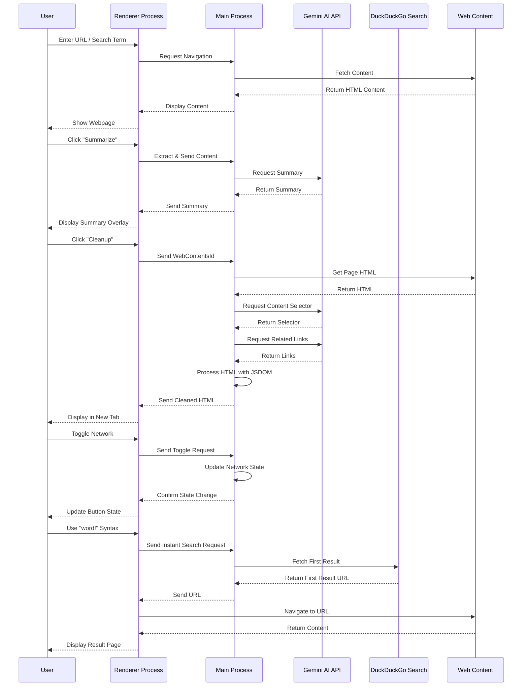

# Browser Application Architecture Diagram

```mermaid
graph TD
    subgraph "Main Process (main.js)"
        A[App Lifecycle] --> B[Window Management]
        B --> C[IPC Handlers]
        C --> D[Network Request Monitoring]
        D --> E[Domain Blocking]
        C --> F[Gemini AI Integration]
        F --> G[Content Summarization]
        F --> H[Content Cleanup]
        F --> I[Related Links Extraction]
        C --> J[DuckDuckGo Integration]
    end

    subgraph "Renderer Process (renderer.js)"
        K[UI Management] --> L[Tab Management]
        L --> M[Webview Control]
        K --> N[User Interactions]
        N --> O[Button Controls]
        N --> P[URL Input]
        K --> Q[Network Visualization]
        K --> R[IPC Communication]
    end

    subgraph "Preload Script (preload.js)"
        S[Context Bridge] --> T[IPC Channel Whitelist]
        S --> U[Secure API Exposure]
        S --> V[Event Listeners]
    end

    subgraph "Component Modules"
        W[TabManager] --> L
        X[Summarizer] --> G
        Y[SearchPanel] --> J
        Z[GeminiService] --> F
    end

    subgraph "User Interface"
        AA[Tab Bar] --> L
        BB[Control Bar] --> O
        CC[Network Activity Bar] --> Q
        DD[Content Area] --> M
    end

    %% Inter-process communication
    R <--> C
    
    %% Component interactions
    W --> M
    X --> R
    Y --> R
    Z --> F
    
    %% External Services
    F <--> EX1[Google Gemini API]
    J <--> EX2[DuckDuckGo]
    
    %% Legend
    classDef process fill:#f9f,stroke:#333,stroke-width:2px
    classDef component fill:#bbf,stroke:#333,stroke-width:1px
    classDef ui fill:#bfb,stroke:#333,stroke-width:1px
    classDef external fill:#fbb,stroke:#333,stroke-width:1px
    
    class A,B,C,D,E,F,G,H,I,J process
    class K,L,M,N,O,P,Q,R process
    class S,T,U,V process
    class W,X,Y,Z component
    class AA,BB,CC,DD ui
    class EX1,EX2 external
```



## Data Flow Diagram



## Component Structure

```mermaid
classDiagram
    class ElectronApp {
        +main.js
        +renderer.js
        +preload.js
        +start()
        +createWindow()
        +handleIPC()
    }
    
    class TabManager {
        -tabs[]
        -activeTabId
        +createTab()
        +closeTab()
        +switchToTab()
        +updateTabTitle()
        +updateTabFavicon()
        +getActiveTab()
        +getActiveWebview()
    }
    
    class Summarizer {
        -webview
        -summarizeButton
        +handleSummarizeClick()
        +displayResults()
        +removeSummaryDiv()
        +updateWebview()
    }
    
    class SearchPanel {
        -panelElement
        -closeButton
        -contentArea
        -searchWebview
        +showPanel()
        +hidePanel()
        +search()
    }
    
    class GeminiService {
        +getGeminiSummary()
        +getCleanedPageContent()
        +getRelatedStoryLinks()
    }
    
    ElectronApp --> TabManager
    ElectronApp --> Summarizer
    ElectronApp --> SearchPanel
    ElectronApp --> GeminiService
    
    TabManager --> "1..*" Tab
    
    class Tab {
        +id
        +url
        +title
        +favicon
        +webview
        +element
    }
    
    class NetworkControl {
        -tabNetworkState
        +toggleNetwork()
        +setNetworkStatus()
        +updateButtonState()
    }
    
    class ContentControl {
        -javascriptDisabled
        -cacheEnabled
        -domainBlockingEnabled
        +toggleJS()
        +toggleCache()
        +toggleDomainBlocking()
    }
    
    ElectronApp --> NetworkControl
    ElectronApp --> ContentControl
